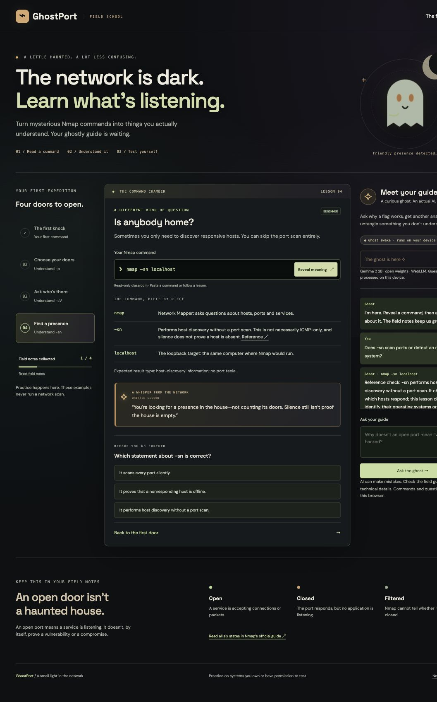

# GhostPort

A slightly haunted Nmap classroom for absolute beginners. Built for Hacktoberfest Week 4: Ghost in the Machine.

## Live demo

[Open GhostPort on Render](https://ghostport.onrender.com/) · [Source on GitHub](https://github.com/Mochi-coder-star/ghostport)



## Start locally

With Node.js 22 or later installed, open a terminal in this project folder and run:

```sh
node server.mjs
```

Then open **http://localhost:8765**. Use the server URL, not a `file://` link: browser modules and WebGPU need an HTTP localhost or HTTPS origin. No dependency installation or API key is needed. Alternatively, serve `dist/` with any static HTTP server.

## What it does

- Four lessons: a first scan, selecting ports, service detection and host discovery.
- Token-by-token command explanations with links to Nmap's official reference.
- Short quizzes, browser-local progress and a reset control.
- A local **Gemma 2 2B** tutor with answers and ghostly analogies.
- Responsive, accessible dark design with drifting mist, a moon and candlelight accents; reduced-motion preferences are respected.

GhostPort never executes an Nmap command or contacts its target hosts. It interprets a supported subset of commands, not the complete Nmap syntax. Quizzes follow the selected lesson even if you edit its command.

## Open-weight AI

The tutor uses `gemma-2-2b-it-q4f16_1-MLC` through **WebLLM 0.2.87** and browser WebGPU. The model downloads only when you select **Wake the ghost**, then inference runs on your own device. Expect approximately 1.5 GB of model downloads and around 2 GB of GPU memory, with actual requirements varying by device. A compatible recent Chrome or Edge browser is recommended. Download progress and retry messages are visible. The written lessons work without the model.

Model output is buffered until a narrow reference check finishes. Known host-discovery/OS confusion and unlocked-door analogies are replaced with precise lesson wording. This check does not catch every possible mistake.

Nmap facts are supplied from the deterministic parser to the model as reference context. Gemma 2 uses a user-role prompt rather than a system role. Model responses are fallible: grounding does not guarantee accuracy or resistance to prompt injection. The referenced lesson explanations remain visible independently.

Commands and chat questions are not sent to a hosted inference API. Lesson progress is stored in browser localStorage. Model/runtime hosts receive normal download requests, and Google Fonts receives font requests. Offline operation has not been verified.

## Publish on Render

Follow [DEPLOYMENT.md](DEPLOYMENT.md). The included `render.yaml` declares a **static site** that runs the tests and publishes `dist/`. You do not need a paid web service, backend, database, API key or environment variables.

## Verification

```sh
node --test tests/*.test.mjs
```

Nine tests cover lesson parsing, malformed inputs, flag conflicts, grounded Gemma messages and the preview server's file boundaries. See [VALIDATION.md](VALIDATION.md) for browser checks and limits.

## Architecture

```text
Command → beginner parser → referenced explanations
                                ↓
Question + reference facts → WebLLM / Gemma on your GPU → answer
Quiz completion → browser localStorage
Render CDN → static application files
```

## Credits

- [Nmap reference](https://nmap.org/book/man.html): original summaries based on official descriptions of [port states](https://nmap.org/book/man-port-scanning-basics.html), [port selection](https://nmap.org/book/man-port-specification.html), [host discovery](https://nmap.org/book/man-host-discovery.html) and [version detection](https://nmap.org/book/man-version-detection.html). Nmap is not bundled and does not endorse this project.
- [Gemma 2](https://ai.google.dev/gemma/docs/gemma2) by Google; [MLC model build](https://huggingface.co/mlc-ai/gemma-2-2b-it-q4f16_1-MLC). Gemma is open-weight and governed by the [Gemma Terms of Use](https://ai.google.dev/gemma/terms), not this project's MIT license.
- [WebLLM](https://github.com/mlc-ai/web-llm), Apache 2.0.
- DM Sans and Space Grotesk through Google Fonts, SIL Open Font License.
- Original inline SVG ghost and CSS atmosphere.

Original application code is MIT licensed. Code, design and documentation were developed with AI assistance using Codex. Review and test any generated educational content. Practice real scans only on systems you own or are authorized to test.

## Competition status

The app is deployed on Render, with public source on GitHub. Gemma powers the local tutor and Render serves its frontend; final prize eligibility is determined by the competition judges.
